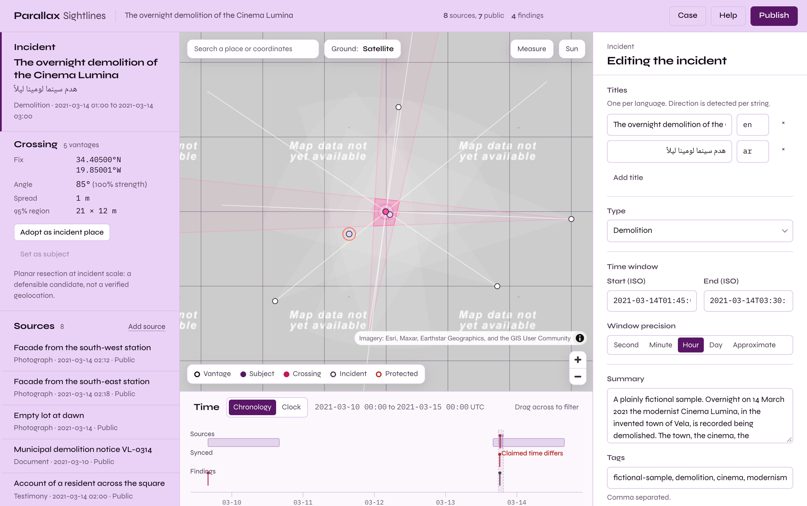
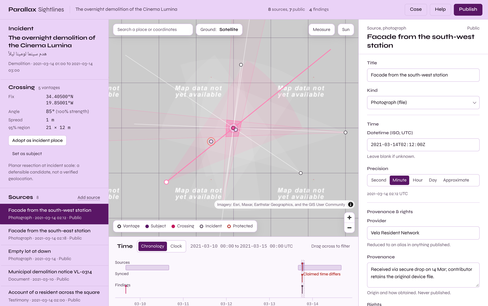
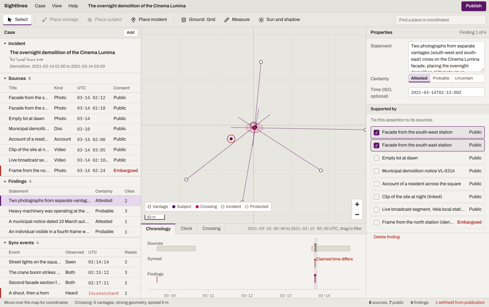
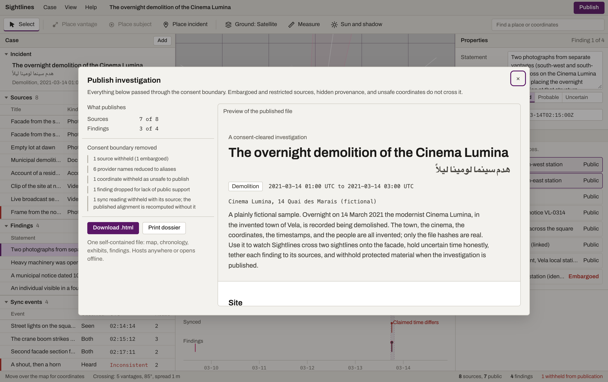
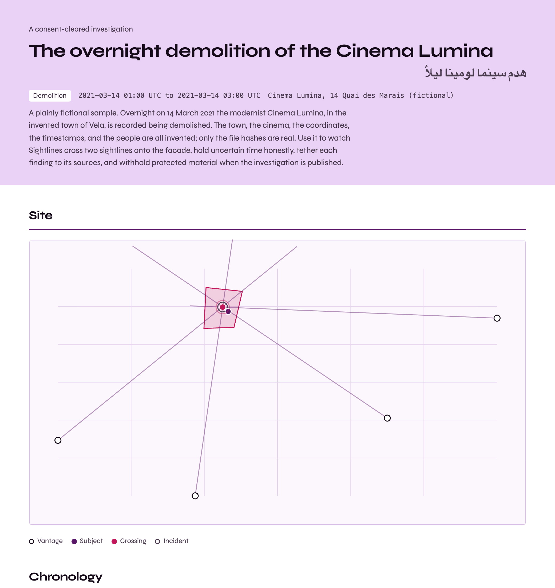

# Sightlines

**Reconstruct one incident or site in time and space, keeping every source tethered to its provenance.**

Sightlines is a client-side, local-first workbench for reconstructing a single
incident or place from scattered material. You gather the sources you hold, hash
what you have, place each photograph's subject and the camera's vantage on a map,
cross the vantage rays to resect a location, order everything on a linked
timeline, and state findings that cite the sources supporting them. The output is
a consent-cleared, self-contained static artifact.

It is the first instrument in the **Parallax** suite. Everything runs in your
browser and no file is uploaded. The map retrieves basemap tiles (satellite by
default), a place search queries a geocoder, and a terrain check samples public
elevation tiles; nothing about your sources or your project rides on any of
these requests, and the offline Grid and File basemaps fetch nothing at all
(see [Privacy and data handling](#privacy-and-data-handling)).



---

## Contents

- [What it is](#what-it-is)
- [How it works](#how-it-works)
- [Install and run](#install-and-run)
- [The interface](#the-interface)
- [The incident](#the-incident)
- [Sources](#sources)
  - [What a source records](#what-a-source-records)
  - [Consent: who may see this source](#consent-who-may-see-this-source)
  - [Hashing and provenance](#hashing-and-provenance)
- [Placing a source on the map](#placing-a-source-on-the-map)
  - [Subject and vantage](#subject-and-vantage)
  - [The bearing dial and field of view](#the-bearing-dial-and-field-of-view)
  - [Terrain line of sight](#terrain-line-of-sight)
- [Crossing sightlines: resection](#crossing-sightlines-resection)
- [The map: basemap, search, and measure](#the-map-basemap-search-and-measure)
- [The chronology](#the-chronology)
- [One clock for many sources](#one-clock-for-many-sources)
  - [Sync events and readings](#sync-events-and-readings)
  - [Anchors and floating groups](#anchors-and-floating-groups)
  - [When a reading disagrees](#when-a-reading-disagrees)
  - [Zones of possible origin](#zones-of-possible-origin)
  - [The claimed time and the synced time](#the-claimed-time-and-the-synced-time)
  - [Sync across the consent boundary](#sync-across-the-consent-boundary)
- [Findings](#findings)
- [Consent and release](#consent-and-release)
- [Publishing](#publishing)
- [Saving and sharing projects](#saving-and-sharing-projects)
- [Starting over: a new investigation, or the sample](#starting-over-a-new-investigation-or-the-sample)
- [A worked example](#a-worked-example-end-to-end)
- [Keyboard and accessibility](#keyboard-and-accessibility)
- [Limits and caveats](#limits-and-caveats)
- [Privacy and data handling](#privacy-and-data-handling)
- [Troubleshooting](#troubleshooting)

---

## What it is

The investigative question Sightlines answers is: **from these scattered images,
documents, and accounts, where and when did this happen, and which sources
establish it?** It is the counter-forensic move applied to a single event: the
official record is silent or wrong, and the material, read together and placed in
space and time, says otherwise.

Its signature is **resection**. A photograph is not only a picture; it is taken
from somewhere, looking in some direction. Place two or more cameras and the
directions they faced, and where the lines of sight cross is a candidate for what
they were all looking at. Sightlines turns that geometry into a working
instrument, with every line tethered to the source that drew it.

What it is **not**:

- Not a verified geolocation service. A crossing is a defensible candidate, not a
  surveyed coordinate. The tool says so, on screen and in the artifact.
- Not a cloud tool. It calls no service at runtime; you bring the material, and
  nothing about the location leaks.
- Not a general GIS or photo manager. It is a focused instrument for one incident
  at a time.

---

## How it works

A Sightlines investigation is built from a few kinds of record:

- **The incident** is the single event or site under reconstruction. It carries
  its titles (one per language), a type, a time window, a summary, tags, and an
  optional place.
- **Sources** are the material you hold: photographs,
  documents, testimony, video. Each carries its kind, a capture time, its
  provider and provenance, rights, a consent level, an optional held file with a
  SHA-256 hash, and any geography it supports (a subject point, a camera vantage).
- **Findings** are source-tethered statements. Each cites the sources that support
  it, carries a certainty, and may be pinned to a time and place.

Everything you publish or export passes through one **consent boundary**, a single
function that decides what may cross. It drops embargoed and restricted sources,
reduces providers to aliases, withholds coordinates marked unsafe, and drops a
finding left with no public support.

Your typed records live in your browser's local storage (IndexedDB), and media
files are held there as blobs. Nothing is sent anywhere. A reload restores your
work.

---

## Install and run

Sightlines is a static client-side app built with Vite.

```bash
cd tools/sightlines
npm install        # first time only
npm run dev        # opens a local dev server (Vite prints the URL)
```

For a production bundle:

```bash
npm run build      # outputs to dist/
npm run preview    # serves the built bundle locally
```

The build is a folder of static files. It runs from any static host or straight
off the filesystem. There is no server component and no build-time secret.

On first launch the app loads a **fictional sample investigation** (an invented
overnight demolition) so there is something to drive immediately. Your work saves
to the browser automatically; a reload restores it.

---

## The interface

Sightlines is laid out like working software.

- The **title bar** carries the menus, the case title, and **Publish**, the one
  primary action. **Case** holds new, open, save, export places, and reset to
  the sample; **View** holds the appearance; **Help** holds About and this guide.
- The **tool bar** holds the tools themselves: **Select**; **Place vantage**,
  **Place subject**, and **Place incident** (a placement tool waits for a click on
  the map, and the two source tools need a source selected); the **Ground**
  control; **Measure**; **Sun and shadow**; and the place search.
- The **Case** pane on the left is an outline of the investigation: the
  incident, then the sources, findings, and sync events as compact tables. Each
  group folds away, and **Add** in the pane's header adds a source, a finding, or
  a sync event.
- The **map** is in the centre, with a key and a scale bar.
- The **Properties** pane on the right edits whatever is selected, as a grid of
  labelled fields grouped under plain headings.
- The **dock** along the bottom has three tabs: the **Chronology**, the
  **Clock** alignment, and the **Crossing**.
- The **status bar** at the foot reports the cursor's coordinates and elevation,
  what the crossing currently says, the counts of sources and findings, and how
  many sources are withheld from publication. Outcomes (saved, imported, reset)
  appear here too.

**Appearance.** Sightlines opens in a light working mode and switches to a dark
one when your system does. View, then Appearance, fixes it to Light or Dark for
this browser; the choice is a viewer's preference and is never saved in the
project. On a narrow screen the panes stack, with the map first.

- Click the **incident** at the top of the Case pane to edit it.
- Click any **source** or **finding** row to select it; the inspector switches to
  its editor, and the map and timeline highlight it.
- The map key names the marker types: vantage, subject, crossing, incident,
  and a red ring for a point that is protected (not safe to publish).
- Each source row gives its title, kind, time, and who may see it, in words. A
  source that is restricted or embargoed reads so in red, with a red rule down
  the row's edge.

Rows in the Case pane are keyboard-navigable: tab to a row and press Enter or Space to
select it.

---

## The incident

Selecting the incident card opens its editor in the inspector:

- **Titles.** One per language; text direction (including right-to-left scripts)
  is detected per string. The first title names the investigation and the saved
  file.
- **Type.** What kind of incident this is (demolition, strike, fire, and so on),
  shown as a tag throughout.
- **Time window.** A **start** and **end** in ISO form, with a **precision**
  (minute, hour, day, or approximate) that controls how times are displayed so the
  reconstruction never implies more precision than it has.
- **Summary.** A prose description, shown in the published artifact.
- **Tags.** Comma-separated keywords.
- **Place.** The incident's location: a name, a latitude and longitude, and a
  **safe to publish** toggle. Set it by typing the coordinates, by pressing
  **Move on map** and clicking, or by adopting a resection crossing (below). When
  the place is marked not safe to publish, the boundary withholds both its
  coordinates and its name.

---

## Sources

Choose **Add**, then **Source**, in the Case pane to add one, then edit it in the
inspector.



### What a source records

- **Title** and **kind** (photograph, document, testimony, video, and so on).
- **Time.** A datetime in ISO form, with the same minute/hour/day/approximate
  precision control. Leave it blank if the time is unknown; an undated source
  simply does not appear on the chronology.
- **Provenance and rights.**
  - **Provider**: who supplied the source. In anything published this is reduced
    to a stable alias (Source A, Source B), and the editor says so beneath the
    field.
  - **Provenance**: how the source was obtained, held for your record only and
    never published.
  - **Rights**: a short rights note that may publish.
- **File.** If you attach a file, the tool records its size, dimensions, and a
  SHA-256 hash, and holds the bytes locally. The hash fixes the file; the original
  is never altered.
- **Photo metadata (EXIF).** For an attached photograph, the tool reads embedded
  metadata where present: the capture time, the device, an embedded GPS position,
  the compass direction the camera faced (with its true or magnetic reference),
  and the focal length with its 35mm equivalent, from which a horizontal field of
  view follows. **Apply to vantage & time** adopts them in one press: the GPS
  becomes the vantage, the direction its bearing, the field of view its cone, and
  the capture time the source's datetime. A photo's GPS is precise, so the
  applied vantage is marked not safe to publish and is withheld from anything
  published (the Geo export, which writes full coordinates for your own use, is
  the stated exception). Test the compass rather than trusting it: a phone's
  bearing is magnetic and casual. EXIF timestamps carry no timezone, so the
  applied time is read in your local zone; correct it if the photo was taken
  elsewhere.
- **Subject** and **vantage**: the geography this source supports (see below).
- **Note.** A short note that may publish.

### Consent: who may see this source

Every source carries one consent level, the heart of the suite's ethic:

- **Public**: included in exports and the published investigation.
- **Restricted**: held for your work only; dropped at the consent boundary.
- **Embargoed**: held but never published, for material shared on condition it is
  not released.

The editor marks the fields that will never cross the boundary, so you can see at
a glance what stays private.

### Hashing and provenance

The SHA-256 hash, computed in the browser with WebCrypto, is the chain-of-custody
anchor: it lets anyone confirm the published artifact refers to the same file you
held, without the file itself being exposed. This is the Berkeley-Protocol
discipline carried into the tool: keep the original unaltered, hash it, record how
it was obtained.

---

## Placing a source on the map

A source becomes spatial when you give it a subject, a vantage, or both. Select
the source, then use the inspector's placement controls or drop a point directly
on the map.

### Subject and vantage

- The **subject** is what the source shows: the point in the world the photograph
  or account is about.
- The **vantage** is where the camera or witness stood, and the direction it
  faced. A vantage is the ingredient resection needs.

To place either, choose **drop a station** for that source and click the map, or
type the coordinates. Each point carries its own **safe to publish** flag, so a
sensitive vantage can be withheld while the subject still shows.

### The bearing dial and field of view

A vantage is a point plus a **bearing** (the compass direction it looked) and an
optional **field of view**. Drag the bearing dial, or type the degrees, and the
ray and its cone redraw on the map. A **confidence** (attested, probable,
uncertain) records how sure the direction is. The bearing is what lets two
vantages cross; the field of view draws the cone so you can see what each camera
could and could not have seen.

### Terrain line of sight

A source with both a vantage and a subject gains a **terrain check** in the
inspector: whether the ground between the two blocks the view. One press samples
a public elevation model (the Terrarium DEM, tokenless) along the line and
returns a verdict, **clear** or **blocked by terrain**, with an elevation
profile, the distance, and either the minimum clearance or the size and position
of the obstruction. Curvature and refraction are corrected, and the observer is
placed 1.6 m above ground. It is a screening check over public elevation data,
not a survey: it knows the ground, not the buildings on it.

---

## Crossing sightlines: resection

This is the signature move. With two or more vantages placed and aimed, their
rays are drawn across the map, and where they cross, the tool computes a **fix**:
a candidate location for the common subject or the incident.

The **Crossing** tab in the dock reports (and the status bar summarises):

- **Fix**: the candidate coordinates.
- **Angle** and **strength**: how squarely the rays cross. Rays meeting near a
  right angle give a strong fix; near-parallel rays are reported as weak geometry,
  not a confident false point.
- **Spread**: the size of the uncertainty where the rays do not meet at a single
  point.
- **95% region**: the crossing's uncertainty, drawn on the map as an ellipse
  around the fix. Each vantage's bearing is given a spread from its stated
  confidence, and the region is where the true point plausibly lies. A shallow
  crossing angle stretches the ellipse along the rays: an elongated region is
  the geometry warning you, not a rendering flourish.

From there you can **Adopt as incident place** (set the incident's location to
the fix) or **Set as subject** for the selected source. The language is
deliberate: the Crossing tab calls this a *planar resection at incident scale, a
defensible candidate, not a verified geolocation*, and that caution travels into
the published artifact.

---

## The map: basemap, search, and measure

The map carries its own small toolkit, added in 1.3.0.

The map's controls are in the tool bar, so nothing floats over the sightlines:
the **Ground** control, **Measure**, **Sun and shadow**, and the search box. The
key and the scale bar sit at the bottom left.

**Basemap.** The **Ground** tool opens a short list of grounds: **Satellite** (Esri
World Imagery, tokenless, the default), **Streets** (OpenStreetMap), **Topo**
(Esri topographic with hillshade), **Grid** (the offline forensic graticule;
nothing is fetched), or **File** (a local `.pmtiles` basemap; nothing is
fetched). **Place labels** overlays place names on the online grounds; on the
offline Grid and File grounds it is switched off, so they stay fetch-free. The
marks change colour with the ground: light over satellite imagery, violet and
raspberry over the light grounds, so they stay legible on both.

**Dated imagery.** With Satellite active, the **Imagery date** choice in the Ground list switches from the
live mosaic to a dated release of the Esri World Imagery Wayback archive. A
photograph claimed to show 2021 can be read against imagery from 2021, which is
often the whole point.

**Search.** The search box takes a place name or a bare coordinate. A typed
`lat, lng` resolves locally with no network call; a place name is sent to the
Nominatim (OpenStreetMap) geocoder, and picking a result flies the map there.

**Measure.** The Measure button starts a path: click to add points, and a small
panel gives the running distance in metres; a third point closes the figure
and adds its area. Undo, Clear, and Done are in the panel; press the Measure tool again to
close it. Measurements are a
reading aid; they are not saved to the project.

**Sun and shadow.** The Sun and shadow tool opens a solar panel for the incident place
and a chosen time: the sun's azimuth and elevation, the shadow direction, and
the day's rise, noon, and set, computed locally with no network call. Drag the
time slider and read whether the light in a photograph agrees with the time it
claims. At the incident's own window the panel says plainly when the sun is
below the horizon.

**What retrieval discloses.** A tile request discloses the tile coordinates of
the area you are viewing to the tile host (Esri or OpenStreetMap); a place
search discloses the search text to the geocoder; a terrain check discloses the
sampled line's tile coordinates to the DEM's host. No source, media, or project
data is ever part of these requests. Grid and File fetch nothing at all.

---

## The chronology

The bottom dock is a linked timeline spanning the incident's window. Dated sources
sit on one track and findings on another, so the sequence is legible at a glance.

- Hover or select an item to highlight it across the map, the Case pane, and the timeline.
- **Drag to filter**: drag across the timeline to limit the view to a time range;
  click an empty part to clear the filter. A drag anywhere brushes a range; a
  click on an item selects it.

A source with no datetime does not appear here; give it a time to place it.

---

## One clock for many sources

Clips of one incident rarely agree about the time. A phone's clock drifts, a
broadcast runs on its own, an upload strips the metadata, and a clip's claimed
time is often only what someone wrote beside it. Sightlines aligns such sources
on one clock from the moments they share: a flash, a boom, a door, a shout,
anything observable in more than one of them. Where Forensic Architecture
synchronises video by its shared sounds and sights, this is the same move,
made explicit and checkable.

Open the dock's **Clock** tab to see the alignment: one track
per synced source, its media drawn from its synced start, with the start's
two-sigma band, and each shared event as a line across the tracks it was read in.

### Sync events and readings

Choose **Add**, then **Sync event**, in the Case pane. An event has a label, how it
was observed (seen, heard, or both), and a set of **readings**, one per source:

- **At (in media).** Where the moment falls in that source's media, as seconds or
  m:ss.s (for example 1:42.3).
- **± seconds.** How precisely you can read it. A flash read frame by frame is a
  tenth of a second or better; a sound heard under wind may be a second or two.
  The alignment weighs each reading by this figure, so state it honestly.
- **Origin bearing from and to, and range.** Optional. From a source with a
  placed vantage, the bearing band in which the moment's origin lies (a muzzle
  flash at the left edge of the frame, a boom heard from the north-west), and how
  far it could plausibly be. These bound where it came from (below).

Give each clip its **duration** in the source's Media clock section, so its span
can be drawn. A photograph is media of zero length.

### Anchors and floating groups

The readings fix only how the sources sit relative to each other. To place them
in absolute time, at least one source must be an **anchor**: a clock you trust,
such as a broadcaster's on-air clock burned into the frame, or a timestamped
upload you have verified. Turn on **Anchor** in the Media clock section, give its
start in ISO UTC, its uncertainty, and the **basis**: why this clock is trusted.
The basis is published with the alignment, so a reader can weigh it.

Sources linked by shared events form a group. A group that reaches an anchor
reads in absolute time. A group that does not is still aligned internally, but
only relative to a reference source, and it is shown as **floating** rather than
given a clock it has not earned.

### When a reading disagrees

Once there are more readings than unknowns, the readings can check each other.
The alignment is a weighted least-squares fit; the reading that fits worst is set
aside if it misses by more than three times its own stated uncertainty, and the
clocks are refitted, until the rest agree. A flagged reading is reported at its
full disagreement against the clean fit and marked in red on the Clock view. It
may mark a splice, an edit, a mislabelled clip, or simply a misread, and that may
itself be a finding.

Where an event has only two readings, they disagree equally and oppositely, so
the evidence shows the event is inconsistent but cannot say which reading is off.
Sightlines then names the event, never a source, and says a third reading would
tell. Where nothing can yet be checked (no redundancy), the editor says so,
rather than implying agreement.

### Zones of possible origin

Where two or more sources with placed vantages give bearing bands for the same
event, the bands are intersected into a **zone of possible origin**, drawn on the
map and given an area. The origin lies inside it; a point outside contradicts at
least one source. One band alone is bounded only by its range, and bands that do
not meet are reported as contradicting each other on where the moment came from.

### The claimed time and the synced time

A source's own claimed datetime is never overwritten. When the synced start, plus
or minus two sigma, falls outside the claimed interval, the source shows both and
flags the disagreement, on the source, on the chronology's synced track, and in
the published artifact. **Adopt the synced time** replaces the claim with the
synced start, to the second; it is a deliberate act, and the disagreement may be
worth keeping as recorded instead.

### Sync across the consent boundary

A withheld source's readings are withheld with it, and the published alignment is
recomputed from the public sources alone, so a withheld reading cannot move a
published clock. An event left with no public readings is dropped. A bearing band
publishes only when its source's vantage does, so a band cannot point back at a
withheld vantage. The artifact's disclosure says how many readings were withheld.

---

## Findings

Choose **Add**, then **Finding**, in the Case pane. A finding is the claim the
reconstruction supports, and it must cite its evidence.



- **Statement.** The finding text, in one or more languages.
- **Certainty.** Attested, probable, or uncertain, shown as a badge and used to
  style the finding in the artifact.
- **Cited sources.** Tick the sources that support the finding. A finding with no
  surviving public support is dropped at the consent boundary, because an
  unsupported claim is not a finding.
- **Time and place.** Optionally pin the finding to a moment and a location, which
  also places it on the chronology.

---

## Consent and release

Two controls govern what may be published, and they are enforced by architecture,
not by discipline:

- A source's **consent level** (public, restricted, embargoed).
- A point's **safe to publish** flag (on the incident place, a subject, or a
  vantage).

When you publish or export, one boundary function (`publicClone`) runs over the
whole project and:

- keeps only public sources, dropping restricted and embargoed ones entirely;
- reduces every provider name to a stable alias;
- withholds a coordinate marked not safe to publish, or coarsens it to roughly a
  kilometre if you choose the coarsen policy;
- drops a finding left with no public support, and reduces a finding's citation
  when a cited source is withheld;
- omits provenance, held file names, and internal keys, because the public record
  has no field for them.

Nothing sensitive can leak by accident, because nothing sensitive crosses this
boundary.

---

## Publishing

**Publish** in the top bar runs the project through the consent boundary and opens
a dialog that shows, side by side:

- **What publishes**: how many sources and findings survive, out of the totals.
- **What the consent boundary removed**: a plain-language list of every
  withholding (sources dropped by consent, providers aliased, coordinates
  withheld, findings dropped or reduced).
- A live **preview that is the artifact**: the same HTML you will download.



**Download .html** gives you a single self-contained file: the site map with the
vantages, subjects, and crossing; the chronology; the findings with their
citations; the sources with their hashes; and a consent disclosure listing
exactly what was removed. It opens offline and hosts anywhere. **Print dossier**
prints the same artifact through a print stylesheet.



---

## Saving and sharing projects

All three are in the **Case** menu.

- **Save project file** saves the whole project as a single `.sightlines.json`
  file, so it round-trips exactly, media included.
- **Open project file** loads a project file back, replacing the current one.
- **Export places** exports the placed points (the incident place, subjects, camera
  vantages with their bearings, the resection crossing, and located findings) as
  **GeoJSON** or **CSV** for QGIS and other mapping tools. Coordinates are
  written in full, so this is for your own use, not the consent-cleared
  publication.

Saving a project file is also how you move an investigation between machines or hand it to a
collaborator.

---

## Starting over: a new investigation, or the sample

Both are in the **Case** menu.

- **New investigation** starts an empty investigation. Because it discards the
  current project, it asks you to confirm first; save the project file if you
  want to keep it.
- **Reset to the sample** replaces the current project with the fictional
  sample, after the same confirmation.

Both confirm in the app itself rather than through a browser dialog, so they
work in an installed app, and the status bar reports the outcome.

---

## A worked example, end to end

1. Add the photographs and documents you hold as **sources**, attaching the files
   so each is hashed.
2. Set each source's **time** and its **provider**, **provenance**, and
   **consent** level.
3. For each photograph, drop its **vantage** on the map and drag the **bearing**
   to the direction it faced, or adopt the photo's own EXIF position and bearing
   in one press; mark a sensitive vantage not safe to publish (an EXIF-applied
   one is marked for you).
4. Read the **crossing** where the rays meet, check its strength, and **adopt it
   as the incident place** if it is sound.
5. Order the sources on the **chronology** and confirm the sequence.
6. Write **findings** that cite the sources establishing them.
7. **Publish**, read what the consent boundary withheld, and download the
   artifact.

---

## Keyboard and accessibility

The Case pane's source, finding, and sync-event rows are reachable by keyboard: tab to a row and
press Enter or Space to select it, with a visible focus ring. Text direction is
detected per string, so right-to-left titles, statements, and notes display
correctly alongside left-to-right text.

---

## Limits and caveats

- **A candidate, not a survey.** A resection crossing is a defensible candidate
  location, not a verified geolocation. Weak (near-parallel) geometry is reported
  as such.
- **You bring the material.** The tool retrieves basemaps and elevation, never
  sources; the reconstruction is only as good as the material you supply and
  place.
- **The terrain check knows the ground, not the city.** The line-of-sight check
  samples a public elevation model; it does not know about buildings, trees, or
  anything built since the model was made.
- **The clock is as good as its readings and its anchor.** The alignment
  assumes each clip plays at its true rate, with no cuts between the readings
  used; a cut shows up as a disagreeing reading, not as a corrected one. An
  anchor's basis is a claim like any other, and the result inherits it.
- **EXIF is a witness, not an authority.** A phone's compass is magnetic and
  casual, its clock carries no timezone, and every field can be edited. Adopt
  the metadata as a starting point and test it.

---

## Privacy and data handling

Sightlines is local-first. Typed records and media live in your browser's
IndexedDB and are never uploaded. The basemap, the place search, and the terrain
check are the retrievals: a tile request discloses the viewed area's tile
coordinates to the tile host, a search discloses its text to the geocoder, and a
terrain check discloses the sampled line's tile coordinates to the DEM's host;
the Grid and File basemaps make no requests at all. No project data rides on any
of these requests. The published artifact is a single file you control; the
consent boundary in particular withholds a photo's embedded GPS wherever a
vantage is marked not safe, so placing a photograph does not leak where it was
taken. Nothing is sent anywhere unless you choose to share the artifact.

---

## Troubleshooting

- **A source is not on the timeline.** It has no datetime. Add one, with an
  appropriate precision.
- **No crossing appears.** Resection needs at least two vantages, each with a
  bearing. Confirm both vantages are placed and aimed.
- **The crossing is flagged weak.** The rays are too near parallel to fix a point
  confidently. A third vantage from a different angle strengthens it.
- **A source will not publish.** Check its consent level; restricted and embargoed
  sources never cross the boundary. A finding citing only withheld sources is
  dropped.
- **Coordinates look rounded in the artifact.** Safe coordinates are capped to
  about a metre of precision; a point marked not safe to publish is withheld
  entirely, or coarsened if you chose that policy.
- **The satellite ground is black or watermarked.** Tiles are still loading, or
  the imagery has no coverage at that zoom for that place (Esri serves a
  watermark tile there). Zoom out, wait, or switch grounds.
- **The terrain check reports an error.** The elevation tiles could not be read:
  offline, blocked, or no coverage. Try again with a connection, or accept the
  check is unavailable there.

---

*Sightlines is part of the Parallax suite. Founded and directed by Jeff O'Brien.*
